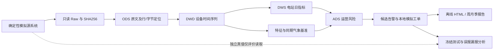

# 户用光伏运营与异常诊断 Pipeline

**合成数据 / SYNTHETIC DEMO。** 本仓库展示从设备日志、质量治理、能量核算，到同期气象发电基准、候选异常、模拟工单与离线运营看板的完整链路。没有真实家庭地址、生产数据、实际维修收益或商业 BI 接入。

Shell 是控制面：检查环境、分阶段调用、日期范围、单实例锁、暂时错误重试、内容校验断点恢复、最终 watermark。Python/DuckDB 是计算面：按日处理、保留血缘、隔离坏行、计算指标、拟合模型和回测。不是一个 Notebook 或只有一次 Python 调用的 run.sh。



## 一键运行

Python 3.12 + Bash。Linux 新环境（不需要 GPU、Docker 或账号）：

```bash
git clone https://github.com/FORGOINGNOW/pv-operations-pipeline.git
cd pv-operations-pipeline
PV_PYTHON=python3 bash scripts/01_bootstrap.sh
bash scripts/00_doctor.sh --config configs/smoke.yaml
bash scripts/90_demo.sh --config configs/smoke.yaml --run-id smoke
# 全年演示：8站，每5分钟，2025-01-01 <= 当地日期 < 2026-01-01
bash scripts/backfill.sh --config configs/demo.yaml --run-id demo-year
# 百站全年：理论主网格 10,512,000 行；这是需单独执行的容量档位
bash scripts/backfill.sh --config configs/full.yaml --run-id full-year
```

Windows PowerShell，使用 **Git Bash 的绝对路径**，不要调用系统 WSL bash.exe：

```powershell
Set-Location 'E:\数据分析\pv-operations-pipeline'
# 当前机器已经建立项目隔离环境；新机器先执行以下两行：
# & 'D:\SoftWare\RealApp\AnaConda\Launch\python.exe' -m venv .venv
# & '.\.venv\Scripts\python.exe' -m pip install -c constraints.txt -e '.[dev]'
& 'D:\SoftWare\RealApp\Git\Git\bin\bash.exe' scripts/90_demo.sh --config configs/smoke.yaml --run-id smoke
& 'D:\SoftWare\RealApp\Git\Git\bin\bash.exe' scripts/backfill.sh --config configs/demo.yaml --run-id demo-year
& 'D:\SoftWare\RealApp\Git\Git\bin\bash.exe' scripts/backfill.sh --config configs/full.yaml --run-id full-year
```

直接打开 `runtime/demo/dashboard/dashboard.html`；JS 和聚合数据均内嵌，无需后端或 CDN。也可仅在本机提供看板目录：

```bash
.venv/bin/python -m http.server 8765 --bind 127.0.0.1 --directory runtime/demo/dashboard
# 浏览器访问 http://127.0.0.1:8765/dashboard.html；Ctrl+C 停止
```

看板包含区域/站点/日期筛选、电量及预期、同行/自身偏差、覆盖/设备可用率、热力图、证据钻取、工单、测试指标、FP/FN 和 CSV 导出。只嵌入站日汇总，不嵌入原始千万行。任何候选原因都需要人工核验。

## 运行与恢复

```bash
# 只计算一个日分区；日期范围结束是左闭右开的 exclusive end
bash scripts/run_daily.sh --config configs/demo.yaml --date 2025-12-01 --run-id daily
bash scripts/backfill.sh --config configs/demo.yaml --start 2025-11-01 --end 2025-12-01 --run-id late-fill
bash scripts/run_daily.sh --config configs/demo.yaml --date 2025-12-01 --dry-run
# --force 重算派生分区，Raw 仍保持只读并校验；改生成配置时使用新的 --root
bash scripts/99_verify.sh --config configs/demo.yaml
```

`backfill` 显式接受超出迟到窗口的记录。`90_demo` 使用默认质量隔离策略，故与 backfill 的保留行数可不同。缺省回看为3天；当前不自动扩展给定日期范围，运维需显式指定回看范围。只有全链路成功才推进 watermark。每步 receipt 包含代码/配置/依赖摘要和输出 SHA256；校验匹配才恢复，不凭文件存在跳过。原始档案/天气也计算校验。

独立步骤：`00_doctor`、`01_bootstrap`、`10_generate`、`20_collect`、`30_clean`、`40_aggregate`、`45_features`、`50_train`、`60_score`、`70_evaluate`、`80_dashboard`、`85_report`、`run_daily`、`backfill`、`90_demo`、`99_verify`。通用数据步骤支持 `--config --date/--start/--end --run-id --dry-run --force --help`；bootstrap 是独立安装入口。

## 口径与模型

- 预测目标是5分钟平均 AC 功率 kW；积分才得到 kWh。同期模拟传感器气象用于诊断基准，**不是日前预测**。
- 物理基线：`Pdc=C×POA/1000×[1+γ(Tcell−25)]`，γ单位为1/°C；`Pac=min(Pdc×0.94×0.965, AC额定功率)`，夜间为0。温升使用辐照和风速近似。
- 轻量模型是 HistGradientBoosting，1–8月训练、9–10月验证选树复杂度、11–12月冻结评价；训练仅用当时可用质量/状态/告警，不能用真值筛除故障。前模型日期只用物理基准。另有扩展时间窗回测。
- 同行剔除自身并按区域、朝向倾角、型号、同期辐照匹配，最少5个有效同行；不足时明确不可判定，以物理基准补充。自身使用严格过去28天的健康 PR 中位数；EWMA 展示历史 PR 趋势。当前自身日基准还没有温度/季节细分条件匹配，见限制。
- 持续异常默认物理残差小于−20%、辐照≥100W/m²、实际持续≥30分钟；长缺口切断、两个正常样本恢复、计划检修抑制。这是演示阈值，不是行业标准；当前尚未完成验证集阈值优化。
- 观测能量只在有限、间隔≤10分钟的端点之间梯形积分；缺失不记零，禁用插值；累计表用于质量核验，不与积分叠加。PR 仅在覆盖充足、POA分母有效时计算。每日最后一个未观测端点不外推。
- 模型 MAE/RMSE 单位kW；容量归一 MAE 的分母为每台逆变器对应的kWp。无样本/无正例指标输出null（N/A），不填1；不报告夜间近零分母的MAPE。

实测数字、截图、资源、CI 与未完成项集中在 [验收记录](docs/acceptance.md)，模型明细见 `reports/demo/evaluation.json`。不预设成功精度，也不将百站能力外推十万站实绩。

## 检查

```bash
.venv/bin/python -m pytest -q
.venv/bin/python -m ruff check src tests scripts/*.py
.venv/bin/python -m ruff format --check src tests scripts/*.py
find scripts -name '*.sh' -print0 | xargs -0 -n1 bash -n
shellcheck -x -P SCRIPTDIR scripts/*.sh scripts/lib/*.sh
.venv/bin/python scripts/verify_sql.py --root runtime/smoke
.venv/bin/python scripts/verify_recovery.py
.venv/bin/python -m pip_audit --skip-editable
```

CI 在 Ubuntu 运行相同检查，仓库 token 只有 contents:read，不部署或发布。Docker、PostgreSQL、cron/systemd 均为可选路径，模板不会修改系统调度。告警只写本地 outbox，不发送 Webhook。

## 文件导航

|目录|职责与证据|
|---|---|
|configs|smoke/demo/full 的版本化参数|
|scripts|Shell控制面、SQL检查、恢复验收|
|src/pv_pipeline|生成、采集、清洗、积分、模型、规则、评价、HTML|
|sql|实测DuckDB窗口/唯一性/查询计划；PostgreSQL示例|
|data/sample|少量确定性合成日志和字段字典|
|tests|业务边界和复现性测试|
|deploy|非root容器、本机数据库映射、调度模板|
|reports|可追溯合成报告样例与截图|
|docs|口径、场景矩阵、部署、Shell学习、面试、来源、验收|

## JD职责映射

|职责|实现|可复核证据|
|---|---|---|
|SQL/Python加工|ODS/DWD/DWS/ADS、SQL窗口|transform.py、sql、质量对账|
|Linux Shell自动化|多步骤、锁、重试、退出码、恢复|common.sh、verify_recovery.py、CI|
|低效识别|同行/自身/物理残差|analytics.py、事件证据|
|模型验证|时间切分、三模型、滚动回测|evaluation.json、rolling_backtest.json|
|监控闭环|候选告警、工单状态、报告|outbox、离线看板|
|可解释沟通|口径、FP/FN、合成声明|docs/interview.md、scenario_matrix.md|

本工程仍有明确边界，尤其是非唯一故障原因、传感器误差、完整故障场景、可用率未知区间及一年衰减混杂。请先读 [限制和验收](docs/acceptance.md)，不要把作品演示描述为真实生产项目。LSTM 明确未实现，核心不依赖 PyTorch。许可证为 MIT，第三方依赖及资料来源见 [sources.md](docs/sources.md)。
